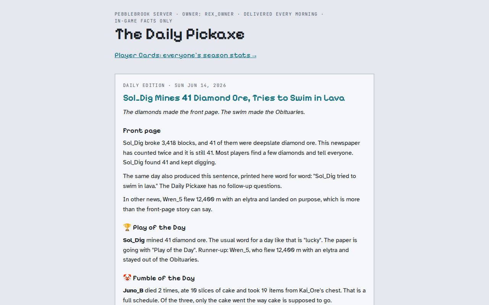

# Masthead – the AI newspaper for your server

Masthead writes a daily newspaper about your Minecraft server and delivers it every morning: as a web page (with a
QR-code map players can scan), as a written book in game, and in the join message. You name the paper and pick its
theme, for example *The Daily Cluck*, "a small-town paper for a town that takes its chickens far too seriously".

- **AI is optional.** Out of the box (`writer.mode: none`) Masthead prints a plain "just the facts" paper: free, no
  key, no AI called.
- **Bring your own AI.** Anthropic's API (about $0.50 to $4 a month on a small server; needs Paper 1.21.11 or newer),
  any OpenAI-format service, or a model on your own machine. Masthead has no service or account of its own.
- **Needs** Paper 1.21.8 or newer (or Purpur). Not Spigot, not Folia. The first start needs internet to download one
  library.
- **Get it:** [Releases](https://github.com/eastmadc/mc-masthead/releases) or [Hangar](https://hangar.papermc.io/eastmadc/Masthead), then [Install](#install).



**What's in an edition**
- A real front-page headline about the day's best story, written from the server's actual stats and events.
- **Obituaries** (the day's deaths, mock-solemn), a **Sports** desk for PvP, two daily **awards** (best play / most chaotic play).
- A **Police Blotter**: players messing with each other's chests, beds, pets and horses (names and counts, never locations).
  It needs an AI writer: the plain edition has no Blotter.
- A **Building Report**: how many blocks each player placed since the last paper and their top materials, from the
  game's own statistics (never where or when; materials that could hint at a place are never named;
  `features.building-report`). When construction news is on, it takes over: the Building Report is left out while
  construction news prints, and otherwise (paused, or `construction.print: false`) lists only players whose builds
  are public.
- **Horoscopes** built on each player's real numbers, a **Weather** report from server TPS, an optional *Animal Watch*.
- An optional **owner column** that lovingly roasts the server owner, with legends you write in the config. With
  `owner.name` set, the web page also gets an owner card and a full owner page (`owner.html`) with the owner's season
  stats, open to anyone with the link; `owner.hours-ok: false` keeps the hours off it.
- **Letters to the Editor**: players write in with `/letter` (a pop-up form); an AI editor picks the best, trims, and answers.
  Players can also send news tips to the editor. Selected tips run anonymously in this section as unconfirmed reader
  reports, separate from the automatic Police Blotter.
- **Player stat cards** on the web page, and `/stats` in game.

## Safety, by design
The writer is instructed to use the server's facts. Automated checks reject large numeric values (three or more digits)
that do not appear in the data, selected unsupported game claims, banned filler, and prohibited content. These checks
do not verify every small count, attribution, or sentence. A failing draft gets up to two rewrites; then Masthead tries
removing the failing section or sentences and rechecks the result before using the plain edition as its final fallback.
Roasts aim at plays: no real life, looks, school or family, no base locations, no accusing anyone of real cheating.
These rules hold at every tone setting.

A built-in "floor" list stops words no setting allows: sexual and body slang, looks and age words, drug slang, slang
that mocks disability, race, gender or sexuality, cheating accusations, name jokes and insults aimed at a person.
Three things open up as the dials go up (the same list is in config.yml): gamer trash talk about a play (skill issue,
noob, ez, washed, dogwater) at `spice: savage` for teens and adults; "sus" jokes at `spice: savage` for adults;
drinking jokes and words whenever `audience` is adults, at any spice. They open up for what the paper itself writes
(the paper, its rewrites and the editor's replies), never for a player's own letter. A "sus" joke still goes back
unless its sentence, or the one before, has a number and no ore, loot or luck word. Insults about builds: the writer
is always told not to, but at `spice: savage` the plugin itself only stops a few fixed phrases ("noob box", "dirt
hut", "spaghetti redstone").

The floor matches whole words and common obfuscations ("gyattt", "gy4tt", "g y a t t"). Game slang can't invent a play
either: "bucket clutch" or "pearled" in a draft whose facts don't show that play sends the draft back for a rewrite.
Style slips (too much slang, a resting word, the same joke shape twice) never cost a rewrite: the paper prints and the
owner's notes say "style: ...".
The word lists know English only (American and British swears).

Custom names on mobs and weapons stay out of the paper: a mob's name tag and a renamed weapon are printed as the
plain type ("slain by Zombie"). The plain edition goes through the same word filter as the AI one.

Player letters never reach the main writer. A separate AI "editor desk" decides what runs, and the plugin then checks
each pick: a quote must be the player's exact words (or their beginning, cut at a word), tips may not name any player,
a letter or tip that gives real-life details in the usual words (an age, a school, a real name, where the writer
lives, a birthday, a social media name), in the player's text or in the editor's answer, is not printed, and large
numeric values are checked against the data. Other wordings of real-life details are left to the AI editor, which is
told to hold them. Reader tips remain unconfirmed reports, not verified server events.
Each player has one letter and one tip a day (a new one replaces the old) and at most 6 sends a day in all: the 7th is
refused until the next day, so one player cannot fill the mailbag.

**Worried letters.** A letter is flagged either by a short built-in phrase list (those never go to the AI) or by the
AI editor when it reads the letter. A letter flagged as worried is withheld from publication. The owner is alerted
about it: right away when the built-in list catches it (even when the AI or the day's paper is down), and at the
next paper when the AI editor flags it. The push is one fixed sentence (with the player's name, except on Discord),
never the letter itself. Because of this the mailroom only opens when there is somewhere to send that push (see
Alerts below).
Without one, the console says `Mailroom is off: it needs an alert channel ...` and `/letter` says the mailroom is closed.
The mailroom also stays closed without an AI writer (`writer.mode: none`, `anthropic` with no API key or on Paper below
1.21.11, or `openai-compatible` without both a `base-url` and a `model`), because only the AI editor prints letters:
`/masthead status` then shows `Mailroom: off (needs an AI writer)`.

## Install
Get the jar from the [GitHub Releases page](https://github.com/eastmadc/mc-masthead/releases) or from [Hangar](https://hangar.papermc.io/eastmadc/Masthead) (the same jar).

**Works on** (tested on a running server):

| server | Java | notes |
|---|---|---|
| Paper 1.21.8 | 21 | the `anthropic` writer needs 1.21.11 or newer (see below) |
| Paper 1.21.11 | 21 | |
| Paper 26.3 | 25 | |
| Purpur 26.3 | 25 | a Paper fork; works the same |

Does **not** run on Spigot or CraftBukkit (Masthead uses Paper's own features, such as rich chat text and the letter
form), on Folia (Folia only loads plugins built for it), or on vanilla or Fabric servers (they can't run Bukkit plugins).
Two mod-and-plugin servers, Youer 26.3 and Arclight 26.1.2, worked in a quick test but are not supported: if
something breaks there, try it on Paper first. If the console says `Unsupported API version 1.21.8`, the server is
older than Paper 1.21.8 and Masthead does not load.

The first start needs internet: the server downloads the Anthropic library and its parts from Maven Central, even
when no AI writer is set.

1. Drop `Masthead-<version>.jar` into `plugins/` and start the server. The plugin targets Paper 1.21.8+ and Java 21 bytecode;
   the server itself needs the Java version required by Paper: Java 21 for 1.21.x, Java 25 for 26.1+.
   **From this first start the web page is open** to anyone who can reach port 8150 on the machine. It shows the
   paper and a stat card for every player with 10 minutes or more of play (name, hours played, deaths and more),
   built from the world's existing stats. To keep it closed from the first start, see the next paragraph.
2. Edit `plugins/Masthead/config.yml`: at least `paper.name`, `web.public-url`, and `writer.mode`. Then `/masthead reload`.
   `web.public-url` is the address players open, ending in `/` (the folder, not `.../index.html`). While it is empty,
   players get no link and no QR code. An empty `web.public-url` does not close the page: only `web.bind` or
   `web.mode: off` does.
3. `/masthead now` writes today's edition; after that it comes out every day at `schedule.time`. With no AI writer it
   is there in seconds. With `writer.mode: anthropic` and the default `batch: true` it takes a few minutes: the console
   says `Writing today's edition (writer anthropic); this can take a few minutes.` and then nothing until it is done;
   set `writer.anthropic.batch: false` for a fast first test. The day's numbers are counted once a day, when the day's
   first paper is written. What you play after that appears in tomorrow's paper, so a first-day paper that says
   nobody played is normal.

**Before the first start (optional).** You may create `plugins/Masthead/config.yml` yourself with only the lines you
want; Masthead fills in the rest at the first start. For example, to keep the web page on this machine only:

```yaml
web:
  bind: "127.0.0.1"    # or  mode: off
```

Masthead then rewrites the file with every setting in it and saves yours next to it as `config.yml.<date-time>.bak`,
which you can delete.

`api-version` is a loading minimum; the table above lists what was actually tested on a running server. See the
[Paper Java requirements](https://docs.papermc.io/paper/getting-started/#requirements) and
[plugin metadata documentation](https://docs.papermc.io/paper/dev/plugin-yml/).

**The first paper comes out almost at once.** If you install after `schedule.time` (05:30 by default), the plugin
publishes today's paper within a minute of the first start, with whatever writer is set (out of the box: `none`, the
plain edition). Create `config.yml` before the first start (see above) if you want the first paper to be the real one.

**Three warnings on a fresh install.** Until it is set up, the console prints these at every start and reload: two
`Mailroom is off: ...` lines (set an alert channel and an AI writer, or `features.mailroom: false`) and
`web.public-url is empty: ...` (set `web.public-url`, or `web.mode: off`). Paper's own warning `A manual
(plugin-induced) save has been detected ...` is expected too: Masthead saves the players' stats before it writes a
paper, so the numbers are fresh.

**A mistake in `config.yml`** (a tab, a missing quote) never resets your settings. `/masthead reload` then changes
nothing and says where to look: `config.yml has a mistake on or above line 12. Nothing was changed. Fix it and run
/masthead reload.` If the server starts with such a file, Masthead stays off (no web page, no paper, no join message)
until a good `/masthead reload`; `/masthead status` says why. A `config.yml` with no setting in it (an empty file, or
only comments) is treated the same way: `config.yml is empty. Nothing was changed. ...` For a fresh file, delete it
and restart the server.

**Updating.** When a new version adds settings, Masthead adds them to your `config.yml` with their comments and logs
which ones. It first saves the old file next to it as `config.yml.<date-time>.bak`, readable only by the server's user,
because it holds your API key and alert addresses; delete it once you're happy. The rewrite keeps your values and
comments, but may change quoting and list layout.

**Who writes it (`writer.mode`)**
| mode | what you need |
|---|---|
| `anthropic` | An Anthropic API key (see "The AI writer and what it costs" below). Paper downloads the official Anthropic Java SDK the first time the plugin loads. Needs Paper 1.21.11 or newer: on older Paper the console says so once and the plain edition is written instead. |
| `openai-compatible` | **Beta.** Any service that speaks the OpenAI chat format (OpenAI, OpenRouter, Gemini, Groq, Mistral, or Ollama / LM Studio on your own machine). Set `base-url` and `model`. Tested by us once: one paper through one paid provider (Anthropic's OpenAI-compatible endpoint). Local models and other providers are not tested by us yet. |
| `command` | A program that reads the prompt on stdin and prints the paper, e.g. the Claude Code CLI (`claude -p`) logged in as the server's user. |
| `exchange` | The plugin drops prompts in `plugins/Masthead/ai/requests/` and a helper outside the server answers them (`tools/masthead-exchange.sh`, with example systemd units in `tools/systemd/`). Use this to keep AI logins away from the server's user. See "Exchange quick start" below. |
| `none` | No AI: a plain "just the facts" edition. |

**Exchange mode: who can read the files.** Requests and answers hold players' letters, so they are readable only by
their owner and the folder's group (mode 640), not by every user on the machine. A helper that runs as the server's
user, or as root, needs nothing more. A helper that runs as another user needs a shared group: put the server's user
and the helper's user in one group, give `ai/requests` and `ai/responses` that group, and `chmod 2770` both. Both
users must be members: the plugin can only hand a request to a group the server's user is in. Without it the AI
writer fails with `exchange helper reported a failure: could not read request` or a timeout. If you run a copy of
`tools/masthead-exchange.sh` from another folder, copy it there again after each update.

**Exchange quick start** (Linux only: the helper needs bash, `flock`, `timeout` and GNU `dd` and `stat`).
1. The `tools/` folder is not in the jar. Get it from the
   [repository](https://github.com/eastmadc/mc-masthead) (Code > Download ZIP).
2. Install the Claude Code CLI for the user that will run the helper, and log in as that user. Test it as that user:
   `echo "Say hi" | claude -p` must print an answer.
3. Set `writer.mode: exchange` and run `/masthead reload`. Masthead then makes `plugins/Masthead/ai/requests` and
   `ai/responses`. With two different users, set the shared group now (see above).
4. Run `/masthead now`, then, while it waits, `tools/masthead-exchange.sh /path/to/plugins/Masthead/ai` by hand. Or
   install the units in `tools/systemd/` (the steps are at the top of `masthead-exchange.service`).

The model is set by the helper, not by `config.yml`: `writer.anthropic.model` does nothing in this mode. Set the
environment variable `MASTHEAD_MODEL` for the helper (default `claude-opus-5-5`).

**The AI writer and what it costs**

Settings live under `writer.anthropic` or `writer.openai-compatible` in `config.yml`; switching modes keeps the other's
values. What we measured with the Anthropic API on a small server (one paper a day, November 2026):

| setup | about |
|---|---|
| Opus 5.5, effort medium, `batch: true` (the default) | $4 a month |
| Opus 5.5, effort medium, `batch: false` | $8 a month |
| Haiku 5.5 (`model: claude-haiku-5-5`), effort high | $0.50 a month |

Every `/masthead now` and every `/masthead preview` calls the AI writer too and costs about one day's paper (plus up to
two rewrites). Use `writer.mode: none` while you test the layout.

- **The key**, first match wins: `api-key-file` (best: a file outside `plugins/` that only the server's user can read),
  then the environment variable (`ANTHROPIC_API_KEY` for anthropic, `MASTHEAD_AI_KEY` for openai-compatible), then
  `api-key` in `config.yml` (the console warns, because anyone with the plugin folder can read it).
- **Batch** sends the day's first draft as a Message Batch at half price. It usually takes 1.5 to 6 minutes; after 20 minutes
  Masthead cancels it and makes a normal call. Anthropic keeps a batch (the day's facts and the paper) until it is
  deleted; Masthead deletes it once it has the paper. If Anthropic refuses the delete (a batch that is still being
  cancelled), the console says so and Anthropic keeps it for 29 days.
- **`writer.monthly-budget-usd`** (default 10) stops paid AI for the rest of the month once Masthead has counted that
  many dollars: the paper comes out plain and you get one alert. Masthead keeps the count in `data/spend.json`; if that
  file is broken or can't be saved, paid AI stays off until you fix it. With the budget enabled, each billable attempt
  first saves a pending marker; an unsettled charge blocks further paid requests even after restart. See
  [ledger recovery](docs/LEDGER-RECOVERY.md#recover-an-unsettled-paid-request) before clearing it. It counts the anthropic and openai-compatible
  modes only. For openai-compatible, it can only count what it knows: OpenRouter reports the cost; for other paid
  providers set `price-per-million-input` and `-output`, or the console warns that the budget can't count them.
- **Construction news** adds at most one more small AI call per published paper, to name the builds (it sees numbers
  and block names only, never player names or places). It is skipped when 10% or less of the monthly budget is left.
- **Big servers.** There is no player limit. When the day's data is too long for one request, the AI gets the most
  active players and the quiet ones are left out of its data (never cut in the middle). The owner's notes then say
  `N quiet players left out of the AI's data`. The checks still use every player's numbers.
- **Also set a spend limit with your AI provider** (a monthly spend limit in the Anthropic Console; a credit limit on an OpenRouter
  key). Masthead's count is a guard, not a bill.

```yaml
# Anthropic's own API.
writer:
  mode: anthropic
  anthropic:
    api-key-file: /srv/minecraft/anthropic-key
    batch: false       # for a fast first test; set it back to true for half price
```

Create the key in the [Anthropic Console](https://console.anthropic.com/) under "API keys". Put only the key in the
file, on one line, then `chmod 600` the file so only the server's user can read it.

```yaml
# OpenRouter (one key, many models). The extra-body keeps your players' data away from hosts that store or train on it.
writer:
  mode: openai-compatible
  openai-compatible:
    base-url: https://openrouter.ai/api/v1
    model: "~anthropic/claude-sonnet-latest"     # any slug from openrouter.ai/models
    api-key-file: /srv/minecraft/openrouter-key
    extra-body:
      provider: { data_collection: deny, zdr: true }
```

```yaml
# Ollama on the same machine (free, nothing leaves the box). Start Ollama with a bigger context first:
#   OLLAMA_CONTEXT_LENGTH=32768 ollama serve
writer:
  mode: openai-compatible
  timeout-seconds: 900
  openai-compatible:
    base-url: http://localhost:11434/v1
    model: llama3.2
```

Free tiers of some providers (for example Gemini's) may keep and review what you send, which includes your players'
names. Use a paid tier or a local model.

**One timed-out request can turn the AI off.** With a budget set, a request to a remote service that times out or is
cut off, and whose cost Masthead cannot know (prices left at 0, or OpenRouter gave no answer), stays "unsettled" in
`data/spend.json`. The paper then comes out plain every day until you clear it by hand: `/masthead status` shows
`AI spend ledger locked: ...` with the file's path; see
[ledger recovery](docs/LEDGER-RECOVERY.md#recover-an-unsettled-paid-request). When the price is known, Masthead counts
the most such a request can have cost and carries on. On a free remote tier you can set
`writer.monthly-budget-usd: 0` from the start: then nothing is counted and nothing can lock, but Masthead no longer
guards your spending.

**Web page (`web.mode`)**: `builtin` serves the paper on its own port (default 8150); `folder` writes the pages into a
folder another web server already serves (e.g. BlueMap's web folder); `off` keeps it in game only. The built-in server
is small on purpose: 16 workers, a request must arrive within 5 seconds, and every connection is closed 15 seconds
after it opens, so a visitor too slow to fetch a file in that time gets it cut short. On a big public server, or one with slow readers, `folder` with a real
web server in front is the better choice. If the port is taken (or your host does not allow it), the console
says `The web page is off: port ...`: set `web.port` to a port your host gives you, or use `folder` or `off`, then
`/masthead reload`. The book and join message keep working meanwhile.

**The web page is public by default.** It has no password: anyone who can reach the port can read the paper, its back
issues and Player Cards. To keep it private, set `web.bind: "127.0.0.1"` (this machine only) or
`web.mode: off`, then `/masthead reload`.

## Commands
| command | who | what |
|---|---|---|
| `/news` (`/news qr`, `/news paper`, `/news write`) | everyone (`masthead.use`) | today's paper: link, QR map, written book, write a letter |
| `/news build ...` | everyone (`masthead.use`) | a player's say over construction news about their builds (see below) |
| `/letter` | `masthead.write` (everyone) | write a letter or send a news tip to the editor (a form opens) |
| `/awards`, `/stats [player]` | everyone (`masthead.use`) | today's awards and why; season stats |
| `/masthead status [share]\|reload\|now\|preview\|selftest` | ops (`masthead.admin`) | status, reload config, publish now, private preview, console check |
| `/masthead construction ...` | ops (`masthead.admin`) | construction news: status and fixes (see below) |

All three permissions are on for the usual people out of the box: `masthead.use` and `masthead.write` for everyone,
`masthead.admin` for ops. Take `masthead.write` away to stop someone sending letters, including through `/news write`.

- Short forms: `/news book` is `/news paper`, `/news letter` is `/news write`, and `/masthead` alone is `/masthead status`.
- `/letter <text>` sends a letter without the form, and `/letter tip <text>` sends a news tip (`/news write` takes the same).
- `preview` writes only under `plugins/Masthead/preview/` (the page, its fonts, Player Cards and the owner page). It
  never changes the published paper, its archive or its files.
- `selftest` (best run from the console) writes `qr-check.png` and prints the join message, awards, stat lines and book pages.
- `status` shows the mailroom (open or off, and why) and today's tries. It also counts the last 7 days' worried letters.
  An admin in game sees their names only when Discord is the only alert channel (see Alerts); otherwise, and always
  in the console, it shows only how many (console logs are kept forever).
- `status share` prints the same report for a bug report: the plugin and server versions first, then no web address, no
  player names and no alert addresses (the API key and each alert channel only say "set" or "not set"). **Still check
  for player names and server addresses before posting, and never paste `config.yml`: it holds your API key and alert
  addresses.**

**Command names.** Masthead adds no extra names of its own. `/masthead:<command>` always works (for example
`/masthead:news`), even when another plugin owns the short name. To add names, list them under `commands:` in the config,
for example `news: [daily, newspaper]` or `masthead: [mhead]`, then restart the server. `build: [permit]` makes `/permit`
the same as `/news build`.

**Construction commands** (only when `features.construction` is on).
- `/news build` shows your setting and what is lined up about your builds; `/news build public` or `private` says
  whether the paper may describe them.
- Standing at one of your builds: `secret` keeps it out of the paper (`unsecret` undoes it), `name <name>` or
  `name clear` names it, `kind <kind>` or `kind clear` says what it is, `done` marks it finished. These count only for
  a build you helped make, from the next paper.
- `/news build forget`, then `/news build forget confirm` within 60 seconds, erases your building records and makes your
  builds private.
- `/masthead construction` shows its status. `pause` and `resume` stop and restart all building news in the paper,
  `clear-name <name>` takes a build's name off, `forget <player>` does `/news build forget` for that player, and
  `reset confirm` deletes every building record (for a world rollback; permit numbers are kept).

**If a day goes wrong.** A day counts as done only when its paper is published. A try that fails, or is cut off by a
restart, is tried again about 10 minutes later, up to 3 times. After that the plain edition is published and the owner
is told why. If even that fails, the owner is told, players keep yesterday's paper, and `/masthead now` tries again.

## Alerts
`alerts.ntfy-url` and `alerts.discord-webhook` send the owner a short note when the paper is out, and when a
letter sounds worried (see "Worried letters" above). **These pushes name players, so keep them private:** the
Discord webhook must go to a private, staff-only channel, and the ntfy topic must be one nobody can guess (it works
like a password). An ntfy address is the full link, for example `https://ntfy.sh/<a long random topic>`, not the
topic name alone. Discord pushes about worried letters never name the player. When Discord is the only channel, an
admin sees who with `/masthead status` in game; with ntfy or the helper below (even alongside Discord), the name
already went to the owner, so `/masthead status` shows only how many. If a push fails, the plugin keeps it and tries
again every 10 minutes; the console says so without the letter text.
With construction news on, the paper-is-out push also carries "Building check" lines and new build names, on ntfy and
Discord alike (see "What leaves your server").

`alerts.helper-pushes-concerns: true` is for an exchange helper that pushes the files in `plugins/Masthead/concern/`
to a grown-up (one small file per worried letter; the helper reads only its `name`). Those files are private to the
server's user, so that helper must run as the server's user or as root. The helper in `tools/` does not push them,
so leave it `false` with that one. `writer.mode: exchange` alone does not count as an alert channel.

**For exchange helper authors.** Request files are named `<date>-t<seconds>-<16 hex>.txt`, for example
`2026-01-15-t360-0123456789abcdef.txt`: the number after `t` is how long the plugin waits for that answer. Give the AI
a little less than that, and skip a request older than it. A request appears in `requests/` only once it is complete
(the plugin writes it next door in `ai/` first), so a helper may watch that folder. Leftover requests and late answers
are deleted when the plugin starts and after each run. `tools/masthead-exchange.sh` always passes a model
(`MASTHEAD_MODEL`, default `claude-opus-5-5`), so the paper does not change with the account's own model setting.
Requests arrive as mode 640 with the group of `requests/`. Write your answers the same way (mode 640, the group of
`responses/`), never readable by everyone.

## Tuning (config.yml)
**Voice.** Out of the box the paper is safe for every age: `audience: all-ages`, `spice: medium`, `language: clean`,
`slang: light`. Pick a mix:

| Server | audience | spice | language | slang | voice | paper.readers |
|---|---|---|---|---|---|---|
| Family server | all-ages | medium | clean | light | (empty: newsroom) | players of all ages |
| Friends 13-17 | teens | spicy | pg13 | heavy | sportscast | a group of friends who play on this server |
| Adult SMP | adults | savage | strong | heavy | group-chat or sportscast | longtime players on this server who can take a roast |

See "Safety, by design" for what `adults` and `savage` open up. A full example for a group of teenage friends is in
[`examples/config-teens-classic.yml`](examples/config-teens-classic.yml).

- `tone.audience` caps the other dials: all-ages allows up to medium / clean / light, teens up to savage / pg13 / heavy,
  adults everything. A value above the cap is lowered and the console says so. An older config without `audience` gets
  the lowest one that keeps the spice and language you set (a setting you never wrote takes today's default).
  `adults` also opens drinking jokes (see Safety).
- `tone.voice`: `newsroom` (a small-town paper taking the server far too seriously), `group-chat` (one of the players
  writing the paper as a bit), `sportscast` (the server's caster: standings, box scores, the best and worst play) or
  `classic` (a shorter, looser prompt: deadpan small-town officialese with room to be funny; no quotas and no
  slang count: slang light is a little (at most one a paragraph), slang heavy writes the way the readers talk from
  its own word list, with the dated-slang check off; the hard lines and the fact check stay).
  Empty picks newsroom for mild/medium and sportscast for spicy/savage.
- `tone.slang`: off · light (up to 2 slang words a paper) · heavy (up to 3; the newsroom voice keeps it at 2). Minecraft's own words (skelly, deepslate,
  advancement titles) are always on, and only when the day's facts back them. Each day the writer gets a short list of
  words the facts support, plus a few example lines; a slang word used in a recent paper rests. These counts and the
  daily word list are for the other voices; classic has no count (see the voice notes in config.yml).
- The word list ships inside the plugin (checked 2026-11-06). Every word has an age tier and a "fresh until" date: a
  fading word is used only at `slang: heavy`, and an expired one never. Add your server's own words with
  `tone.lexicon.add` (`{term, means, kind: game|slang, tier}`, means up to 60 characters: what the word means, never an
  order, a place or a play the facts can't show) and drop shipped ones with `tone.lexicon.remove` (a removed slang word or read is
  never offered and is sent back if a draft uses it; remove one and add it back to redefine it, at its shipped age tier
  or higher). Quote words YAML reads as yes/no (`"yes"`, `"no"`, `"on"`, `"off"`). Words on the floor, and plays the paper can't check (xp farm, crits), can't be added. Write
  `slang: "off"` in quotes, or YAML may read it as a yes/no (Masthead reads an unquoted off as off too).
- The classic voice at slang heavy has its own word list (it is in config.yml); `tone.lexicon.remove` and `add` change
  it too. Careful with its everyday words (ate, the way, nah, fr): removing one also sends back its plain use ("ate
  3 steak").
- A list setting with one value may be written without brackets (`hide-players: Steve`). A name made only of digits
  still needs them (`[12345]`).

**Spelling.** `paper.language`: `en-US` (the default: color, favorite, "Sat Nov 14, 2026") or `en-GB` (colour,
favourite, "Sat 14 Nov 2026"). It tells the AI which spelling and words to use, and sets how the plugin prints dates.
It is not `tone.language`, which is how much the paper swears.

`tone.length` short · normal · long —
`tone.bits` obituaries, sports, weather, horoscopes, market, classifieds, animal-watch — `owner.*` the owner column —
`privacy.hide-players` (never named), `privacy.never-mention` (topics the paper must avoid) and
`privacy.retention-days` (how long the day's facts and stats copies are kept, default 40).

With `owner.hours-ok: false` the owner's hours stay off the paper, the web pages and `/stats`. On Player Cards the
owner's card is then listed first (not in hours order), and the owner holds no hours rank and no per-hour title or
badge: those go to the next player.

**Construction news** (`features.construction`, off by default) adds a Planning & Zoning section about players'
builds, never where they are. The `construction:` block in config.yml explains each option. The newer ones:
`detail` (basic | standard | full: how much it says about what a build is and what is inside; standard leaves out
loot and biome hints), `sign-names` (a builder's sign that reads like a place can name their unnamed build; off by
default) and `survey-names` (print the names in your optional survey file; off by default). The survey file,
`plugins/Masthead/construction/survey.json`, lists older builds you found yourself, with their kind, builders and
what is inside. The opening edition, the first paper with construction news, puts them on the register and on the
Town Survey page. A player's builds can be printed from two days after that player first got the one-time building
notice in chat, which is usually the second paper after it.

## Your data
> **In short, for players and parents**
> - A Player Card shows a player's Minecraft name and game numbers: hours played, deaths, kills, blocks mined and more.
> - Anyone who has the web page's address can read the paper and the cards. There is no password.
> - To be taken off, ask the server owner. The owner adds the name to `privacy.hide-players`, then runs
>   `/masthead reload` and `/masthead now`.
> - A later name change is followed automatically, once Masthead has seen the player under the listed name.

Everything stays in `plugins/Masthead/`, apart from what "What leaves your server" lists below. Readership counts come
from the web log; which player read it goes only to the owner's notification, never into the paper.

**Addresses** never leave the server, and are kept only while `features.readership` is on:
- `ip-players.txt`: the address each player joined from, kept 60 days after that player last joined from it.
- `web-access.log` (and `web-access.log.1`): each visitor's address, the time and the page. Only the built-in web
  server writes it. Lines are removed after 60 days (in the daily clean-up after a published paper). At most 64 KB a
  day is logged per visitor address, and 4 MB a day in all. Behind a proxy every visitor shares one address, so the
  log stops at 64 KB a day and the reader count is 1 at most, and 0 when the proxy is on the same machine (visits
  from 127.0.0.1 are not counted).
- With `features.readership: false` there is no log. `web-access.log` is not written, and old ones are deleted at
  start-up and on `/masthead reload`. `ip-players.txt` is deleted at the next restart (the reload message asks for
  one).
- In `folder` mode, point `web.access-log` at your own web server's log somewhere else. `plugins/Masthead/web-access.log`
  belongs to the plugin: it is trimmed and may be deleted. If that web server empties its log at a restart, that day's
  readers are lost and the owner's note may say 0 readers.

**How long things are kept.** `privacy.retention-days` (40) covers the day's facts file (`data/DATE.json`, which
keeps no letters and no reader names) and the daily stats copies (`stats/`). These folders do not follow it:
`events/` (joins, deaths and advancements) and `health/` are kept 40 days, `blotter/` 14 days, letters (`mailroom/`)
7 days. The paper's archive (`editions/`) is kept. Smaller files:
- `desk/` (the AI editor's picks, which quote letters): 7 days.
- `mailbag-printed.jsonl` (whose letter or tip was printed; no text): 8 days.
- Worried letters: `concern-sent.txt` keeps the writers' names 10 days. An alert that could not be sent waits in
  `concern-outbox/` and loses the letter's text after 7 days. With `alerts.helper-pushes-concerns`, `concern/` holds
  the letter for 7 days.
- `construction/` (construction news): where each player built, to the nearest 4 blocks, for up to 7 days; the list
  of builds until a build is forgotten (`construction.forget-after-days`) or
  `/masthead construction reset confirm`.

Most of these are cleaned when a paper is published, so they stay longer while no paper comes out.

**Who can read the files.** The plugin's data files are private to the server's user (files 600, folders 700) where
the disk supports it. Three exceptions: `editions/` and the web pages are left readable for your web server; in
exchange mode the prompts (which hold players' letters) pass through `ai/`, where the group of `ai/requests` can read
requests and the group of `ai/responses` can read answers; and a few small files (`qr-check.png`, a day's
`health/` file) get your system's default mode until the next published paper or restart. The folders that hold
player names and what they did (`events/`, `health/`, `blotter/`, `data/`, `stats/` and `preview/`) are private from
the moment they are made.

**Taking something back.** Adding a player to `privacy.hide-players` (then `/masthead reload`), `/news build private`,
`secret` and `forget` count from the next paper.
- Today's paper stays as printed (web page, `/news`, the book) until then; `/masthead now` writes it again. The
  reload says so when a name was added. A book a player already took cannot be recalled or replaced.
- A hidden player who changes their Minecraft name stays hidden, once Masthead has seen them under the listed name
  (online, or in a daily stats copy that is still kept). The console then says `hidden player X is now called Y;
  still hidden. Add Y to privacy.hide-players.` Leave the old name in the list: taking it out un-hides the player.
- Hiding stops printing, not recording. For a hidden player Masthead still keeps the daily stats copies (`stats/`),
  joins and deaths (`events/`), Blotter lines (`blotter/`) and the join address (`ip-players.txt`). Letters they
  sent earlier stay in `mailroom/` and `mailbag-printed.jsonl`, and the day's facts from before they were hidden in
  `data/`. All of it is private to the server's user and is deleted after the times listed above. `state.yml` keeps a
  hidden player's UUID and names, so a name change can be followed.
- There is no erase command. To erase one player sooner, delete by hand: their `<uuid>.json` and their entry in
  `usercache.json` in each `stats/DATE/` folder, their lines in `events/`, `blotter/`, `mailroom/`,
  `mailbag-printed.jsonl` and `ip-players.txt`, the `data/DATE.json` files and the papers in `editions/` that name
  them, and (with the server stopped) their entry under `hidden-uuids` in `state.yml`.
  `/masthead construction forget <player>` erases their building records.
- On the front page, back issues then show a hidden player as "a player", and they never show old building news (the
  building section and lines such as "Permit #..." are left out; rarely an ordinary line that reads like one goes
  too).
- Not caught: a look-alike spelling (Bob22 for Bob_22), a build name in an old headline or in other text, and an old
  building section if you changed `construction.title` since.
- Papers already printed are not rewritten. To take one down, delete or edit its file in
  `plugins/Masthead/editions/`; the front page drops it at the next paper or `/masthead now`. If your own web server
  serves `editions/`, those files still hold the old names.

The web pages ask search engines not to list or keep copies of them (`noindex, noarchive`). That is a request: it
does not stop anyone who has the address.

The web pages load nothing from other websites: their three fonts are written next to the pages (`fonts/`). The server
itself contacts one outside place on its own: the first time the plugin loads, Paper downloads
`com.anthropic:anthropic-java:3.5.0` and its parts from Maven Central or Paper's default mirror. Paper fetches them by
version only, with no checksum pinning, so it trusts Maven Central (or the mirror) at that first load.

### What leaves your server
Masthead has no telemetry, no update check and no bStats. This is everything it sends out:

| Destination | When | What is sent |
|---|---|---|
| Maven Central (or Paper's mirror) | First load, **every** writer mode | Download of `anthropic-java:3.5.0` and its parts. The server blocks loading if outbound downloads are blocked. |
| `api.anthropic.com` | `writer.mode: anthropic` | Style prompt (it includes your `privacy.never-mention` topics) plus the day's facts: player names, stats, deaths, advancements, PvP, blotter names and counts, build counts, owner lore; with construction news on, each build's kind, size, what is inside and its name (a `/news build name`, or an accepted sign name when `sign-names` is on). The editor-desk call also sends player letters with their senders' names, and news tips without them. Letters that match a short built-in list of worry phrases, and letters or tips that name a player on `privacy.hide-players`, are never sent. Every other letter is sent with the sender's name, including ones the AI editor then flags as worried. With batch, the batch is deleted after use when Anthropic allows it; if the delete fails the console says so and Anthropic keeps it for 29 days. |
| Your `base-url` (OpenRouter, Gemini, Ollama and so on) | `openai-compatible` | Same as above. |
| Whatever your program contacts | `command` or `exchange` | Same as above, via your CLI. For example, `claude -p` sends it to Anthropic. |
| Your ntfy topic or Discord webhook | `alerts.*` | Paper summary, the names of yesterday's readers, letter counts and short status notes. With construction news on: "Building check" lines (who broke about how many blocks of whose build, also for players who chose `/news build private`; never for `privacy.hide-players`) and new or cleared build names with their builders. Discord gets these names too. The name of the player who wrote a worried letter (ntfy and the helper only; Discord gets no name). |

- Check your AI provider's own privacy page for how it keeps and uses this data. For Anthropic, see
  [model training](https://privacy.claude.com/en/articles/7996868-is-my-data-used-for-model-training) and
  [data retention](https://privacy.claude.com/en/articles/7996866).
- Free tiers of some providers may keep or train on the data you send.
- If your players are under 18, check your AI provider's rules for products used by minors: you are the operator. Or
  use a model on your own machine.
- Your ntfy topic name works like a password: anyone who knows it can read your alerts. Pick a long, random one.
- IP addresses never leave the server.
- The web page is not sent anywhere, but with `web.mode: builtin` anyone who can reach its port (8150 by default) can
  open it. See "Web page" above.
- The build-kinds call (construction news, AI writers only) sends numbers and block names under stand-in letters:
  block counts, height and footprint, overworld or not, how many builders and building days, water buckets poured,
  the share of blocks in slime chunks, deaths by mob type. No player names, build names, sign text or x/z positions.

**If your host blocks outbound downloads**, Masthead will not load at all, even in plain mode, because Paper fetches
the Anthropic library before any of Masthead's code runs, in every writer mode. Allow Maven Central once, or ask your
host to.

## Building
`tools/fetch-libs.sh` (downloads the compile-time jars, checksum-verified), then `./build.sh` or `./build.sh test`.
Use JDK 25 and set `JAVA_HOME` to it. The published hash comes from a git clone of the release tag built with Temurin
25.0.5.1+2, the JDK the GitHub build uses. The source zip gives a working jar with a different hash, and another JDK version may too.

## Third-party
Bundled in the jar:
- **QR Code generator** by Project Nayuki: MIT. License: `LICENSE-qrcodegen.txt` at the jar root.
- **Fonts**, unmodified from the google/fonts repository, all SIL Open Font License 1.1. Each license sits next to
  its font files, at the same path in the jar and in the web output: Pixelify Sans
  (`fonts/pixelify-sans/OFL.txt`), Atkinson Hyperlegible (`fonts/atkinson-hyperlegible/OFL.txt`) and JetBrains Mono
  (`fonts/jetbrains-mono/OFL.txt`).

Not bundled: Paper downloads these on first load (see "Your data"):
- `com.anthropic:anthropic-java` 3.5.0: Apache-2.0 (the SDK moved from MIT to Apache-2.0 at 3.0.0).
- Its parts OkHttp, Okio, Jackson and the Kotlin standard library: Apache-2.0.

## How it was made
Masthead's code was written with help from AI coding tools. The icon was made with an AI image tool (see
`branding/README.md`).

## Support
Masthead is a hobby project, and support is best effort. See [SUPPORT.md](SUPPORT.md). Report security problems
privately, as described in [SECURITY.md](SECURITY.md).

## License
Masthead is released under the MIT License. See [LICENSE](LICENSE). Bundled third-party parts keep their own licenses
(see "Third-party" above and `src/main/resources/THIRD-PARTY.txt`).
